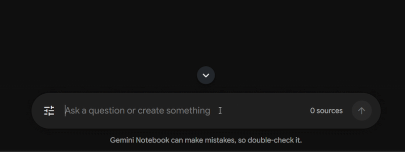
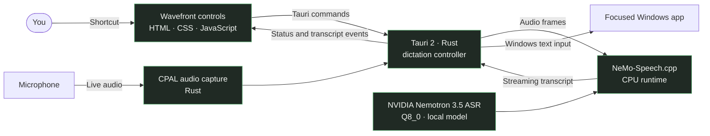

<div align="center">
  <h1>
    
    &nbsp;&nbsp;
    <strong>Wavefront</strong>
  </h1>
</div>

Wavefront is a Windows app built with Tauri, Rust, and a plain HTML frontend. It captures microphone audio with CPAL, streams it to NVIDIA Nemotron 3.5 ASR through the NeMo-Speech.cpp CPU runtime, and inserts recognized text into the focused Windows text field.

<p align="center">
  
</p>

## Why Privacy Matters

Wavefront is designed with privacy in mind. It runs entirely on your local machine, ensuring that your voice data never leaves your device. Unlike cloud-based dictation services, Wavefront does not send your audio to external servers for processing. This means that your speech remains private and secure, giving you peace of mind while using the application.


## Features
- System-wide voice dictation.
- Automatic and live text insertion into the currently focused application.
- On-device CPU inference.
- Local model caching after the initial download.

## Local Build

Requirements: Windows, Rust stable with the `x86_64-pc-windows-msvc` target, Visual Studio C++ Build Tools, Windows SDK, and WebView2. No frontend package install is needed.

```powershell
./scripts/run-dev.ps1
./scripts/build-installer.ps1
```

The installer script downloads the NeMo-Speech.cpp runtime and verifies its SHA-256 checksum before packaging it. On first launch, Wavefront downloads the Nemotron Q8_0 model, verifies it, and caches it locally. Both downloads require an internet connection; recognition runs on the CPU.

## How it works



The model runs locally on the CPU. An internet connection is only needed to download the speech runtime during installer builds and the model on first launch.

Download the latest release from [Github](https://github.com/Vinayak2005917/Wavefront/releases/tag/First_release) or [Microsoft Store](https://apps.microsoft.com/detail/9PLW5T13V1BJ?hl=en-us&gl=IN&ocid=pdpshare).

## Contributing & License

Contributions are welcome. Open an issue to report a bug or suggest an improvement, or submit a pull request with a clear description of the change. Please test changes on Windows and include any relevant steps to reproduce or verify them.

By contributing, you agree that your contributions will be released under the same terms as this project. Wavefront is licensed under the [MIT License](LICENSE), which permits use, modification, and distribution with attribution and the license notice included.


